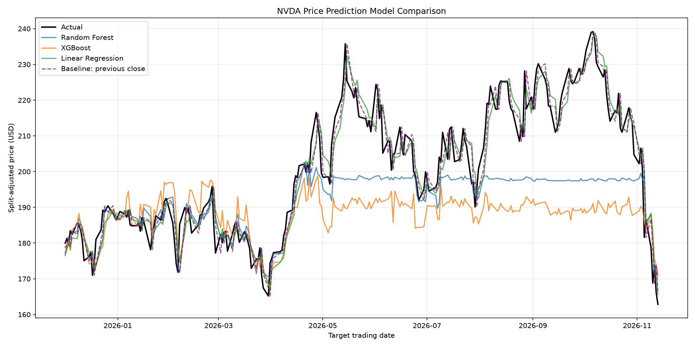

# NVIDIA Stock Price Predictor

I built this project to learn how machine learning can be used to predict stock prices. It uses historical NVIDIA (NVDA) data from Alpaca to predict the next trading day's closing price.

## How it works

I downloaded daily stock data and created six features:
- Closing price
- Trading volume
- 5-day volatility
- 5-day moving average
- 10-day moving average
- 20-day moving average

I used the first 80% of the data for training and the remaining 20% for testing, keeping the dates in order.

## Models I used

- Random Forest
- XGBoost
- Linear Regression

I also added a simple baseline that predicts tomorrow's closing price will be the same as today's.

## Results

I compared the predictions using Mean Absolute Error (MAE). Lower values mean smaller errors.

| Model | MAE (USD) |
|---|---:|
| Baseline | 3.78 |
| Linear Regression | 4.12 |
| Random Forest | 11.05 |
| XGBoost | 15.69 |

The baseline performed better than all three models. Linear Regression looked close to the actual prices on the chart, but its average error was still higher than the baseline.

## Libraries used

Python, pandas, Matplotlib, scikit-learn, XGBoost, alpaca-py, and python-dotenv.

## Output files

- `model_comparison.png` — chart of actual and predicted prices
- `model_scores.csv` — MAE scores
- `next_session_forecasts.csv` — forecasts with the data cutoff date

## Prediction comparison



## What I learned

A model can look accurate on a chart without beating a simple prediction method. Comparing it against a baseline helped me understand the results better.

The current dataset ends on November 13, 2026. These results are from one stock and one test period, so they don't show how the models would perform in every market condition.

## How to run

I used Python 3.12 for this project. These commands are for Windows PowerShell. You will also need an Alpaca account with an API key and secret key.

First, clone the repository and open its folder in VS Code:

```powershell
git clone https://github.com/Adharsh818/nvidia-stock-price-predictor.git
cd nvidia-stock-price-predictor
```

Run the following commands in the terminal inside that folder:

1. Create a virtual environment:
   ```powershell
   python -m venv .venv
   ```

2. Activate it:
   ```powershell
   .\.venv\Scripts\Activate.ps1
   ```

3. Install the dependencies:
   ```powershell
   python -m pip install -r requirements.txt
   ```

4. Create a `.env` file beside `stock_predictor.py` and add your own Alpaca credentials:
   ```dotenv
   ALPACA_API_KEY=your_api_key
   ALPACA_SECRET_KEY=your_secret_key
   ```

   Replace the placeholders with your own keys. Keep `.env` private; it is excluded by `.gitignore`.

5. Run the script:
   ```powershell
   python stock_predictor.py
   ```

The script prints the model errors and next-session forecasts, saves the three output files listed above, and opens the comparison chart. The forecast uses the fixed November 13, 2026 data cutoff; it is not a live forecast.
